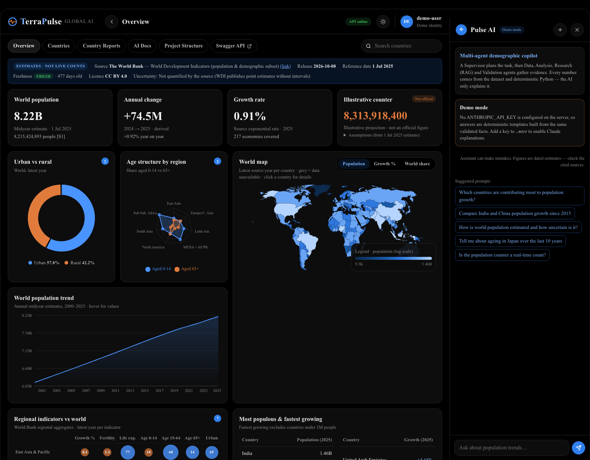
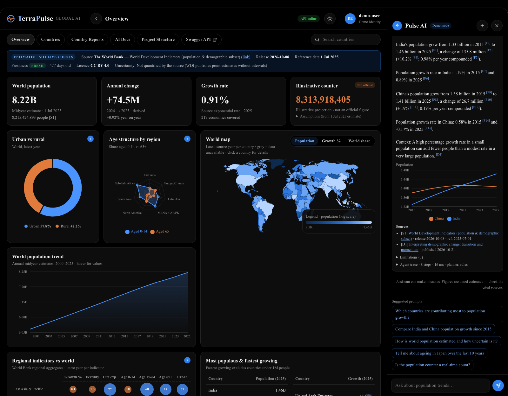
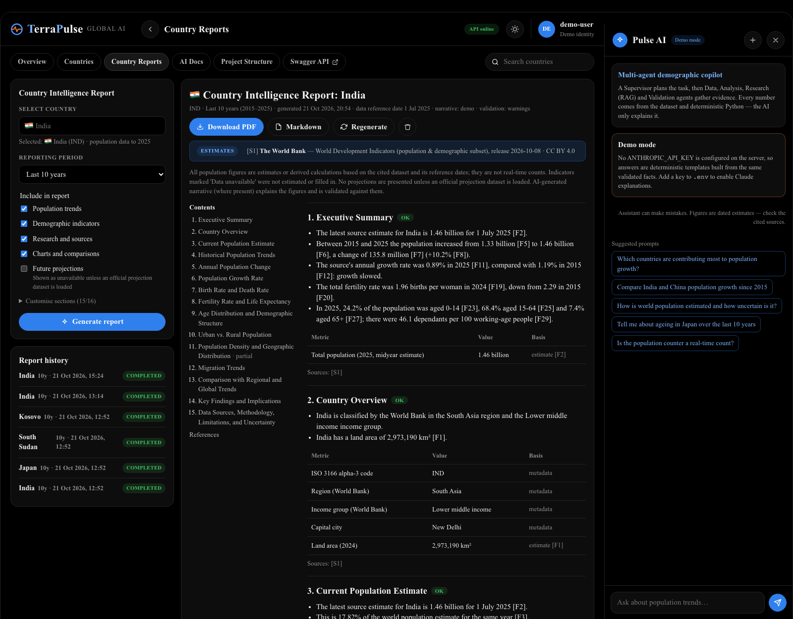
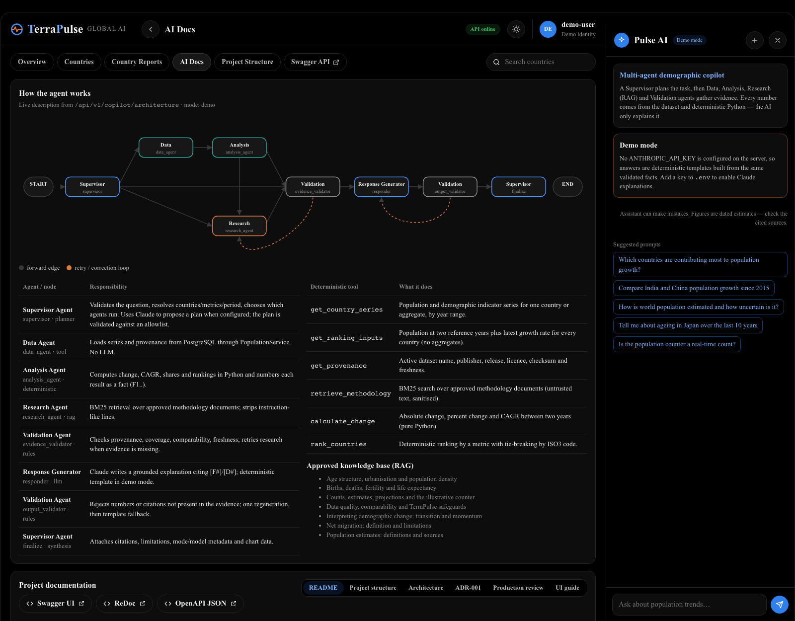
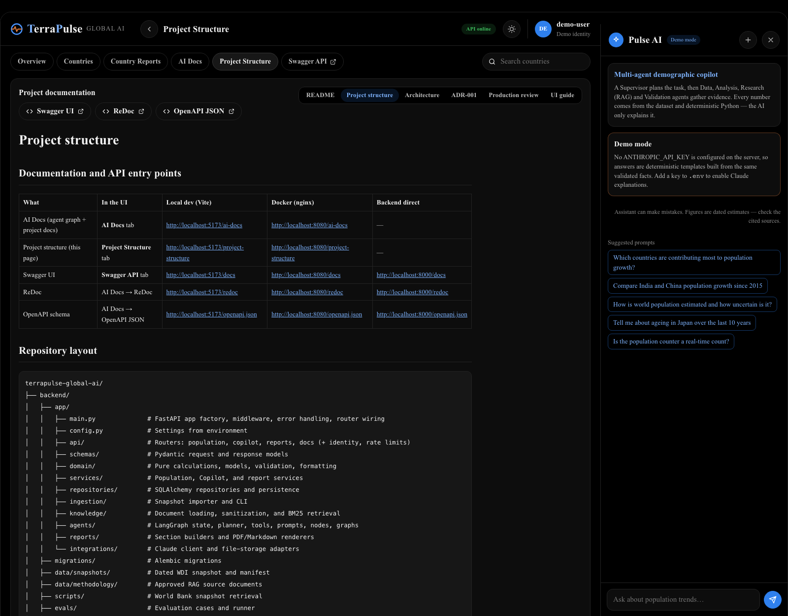
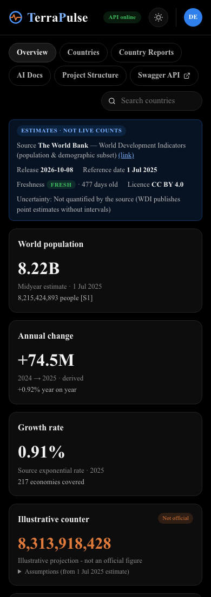

# UI guide

The interface is an analytics dashboard with a **light and a dark theme** (pure black background, no violet or purple in
either). It follows the OS preference until the user picks one with the sun/moon button in the top bar; the choice is
saved in the browser. All text uses Times New Roman. The layout is a top bar with breadcrumb and status, pill tabs, KPI tiles,
a chart grid, a world map with a legend card, a bubble matrix, and a docked AI copilot panel on the right.

## Pages

| Page | What it shows | Key interactions |
|---|---|---|
| **Overview** (`/`) | Provenance banner; KPI tiles (world estimate, annual change, growth rate, labelled illustrative counter); urban vs rural; age structure radar by region; world population trend; choropleth map; regional bubble matrix; most populous and fastest growing tables | Hover any chart for exact values; switch the map metric (Population / Growth % / World share); click a country to open it in Countries |
| **Countries** (`/countries?c=ISO3`) | Sortable and searchable country table; indicator history chart with derived change and CAGR | Top-bar search, region filter, column sorting, indicator toggle, **Generate report** |
| **Country Reports** (`/reports`) | Report form (country combobox, period, section groups and individual sections), report history, preview with table of contents | Generate (progress bar while the job runs), download PDF or Markdown, regenerate, delete |
| **AI Docs** (`/ai-docs`) | Live LangGraph diagram, agent responsibilities, deterministic tools, RAG corpus, and the rendered README, project structure, architecture, ADR, review and this guide | Tabs switch documents; buttons open Swagger UI, ReDoc and the OpenAPI schema |
| **Project Structure** (`/project-structure`) | Annotated repository tree, routes and every documentation/API URL | Same document viewer, opened on the project structure |
| **Swagger API** (`/docs`) | FastAPI's interactive API documentation | Opens in a new tab |
| **Pulse AI panel** (all pages) | Suggested prompts, chat, answer with inline chart, sources, limitations, validation badge, per-agent trace | Enter to send, Shift+Enter for a newline; **+** clears the conversation; **×** hides the panel |

## Honesty cues

* **Estimates · not live counts** tag in every provenance banner.
* **Freshness** tag (`fresh`/`stale`) with age in days.
* **Demo data** tag whenever the active dataset is synthetic.
* **Not official** tag and expandable assumptions on the illustrative counter.
* Copilot answers show their mode: `Claude · <model>`, `Demo mode · no LLM`, or `Fallback · deterministic`.
* Reports mark sections `ok`, `partial` or `unavailable` and list each missing indicator as "Data unavailable".

## Colour and charts

Every colour is a CSS custom property in `frontend/src/styles.css`, defined once for light and once for dark, so the
charts, map and UI switch together without re-rendering.

| Role | Light | Dark | Use |
|---|---|---|---|
| Series 1 / accent | `#1f6feb` blue | `#4a94ff` blue | Primary series; "at or above world" in the bubble matrix |
| Series 2 | `#c8611f` orange | `#e07b3c` orange | Second series; "below world"; negative growth on the map |
| Series 3 | `#0f8a7c` teal | `#23a898` teal | Third series |

* **Sequential** (map population and share): one blue hue, six steps, log-scaled population; the ramp runs from
  low contrast to high contrast against the card surface in each theme.
* **Diverging** (map growth): orange (decline) ← grey (≈ 0) → blue (growth).
* Identity is never colour-only: legends for every multi-series chart, direct labels on the urban/rural donut,
  numbers inside bubbles, and tooltips everywhere.
* Chart animations are disabled, so charts render immediately and respect reduced-motion preferences. The counter
  stops ticking under `prefers-reduced-motion`.

## Accessibility

* Landmarks (`header`, `nav`, `main`, `aside`), labelled sections, `aria-live` for Copilot answers and progress.
* Charts have `role="img"` with descriptive labels; the bubble matrix is a real `<table>` with a caption.
* Keyboard: the country combobox supports arrows, Enter and Escape; table rows are focusable; visible focus rings.
* States: skeleton loaders, empty states (no dataset, no reports, no matches) and error states with the request ID
  and a retry button.

## Responsive behaviour

* ≥ 1280 px: copilot docked on the right.
* < 1280 px: copilot moves below the content; KPI tiles in two columns.
* < 900 px: single-column cards; report table of contents above the content.
* < 560 px: single-column KPIs; 16 px side gutters.

## Screenshots

